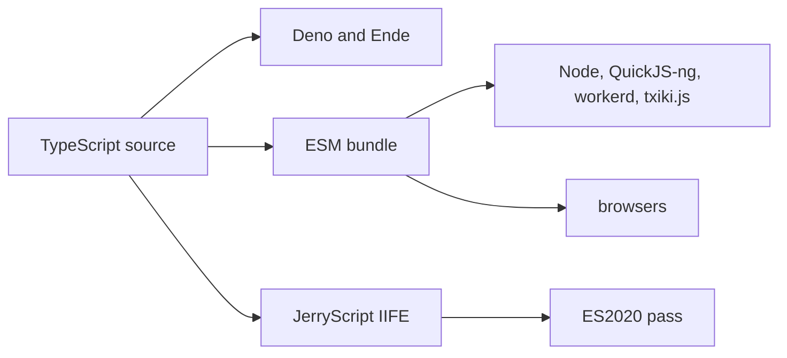

# @neotales/<module>

## Overview

One or two sentences. What the module does, and what it does not do.


[](https://jsr.io/@neotales/<module>)
[](https://badge.fury.io/js/@neotales%2F<module>)

A diagram, a gif, or a picture belongs here when it shows the idea faster than a paragraph. Commit it next to this file. Do not hotlink a meme that will disappear. A mermaid diagram needs no file.



## Documentation

Documentation is available on [jsr.io](https://jsr.io/@neotales/<module>/doc).

## Installation

```bash
# Deno
deno add jsr:@neotales/<module>

# npm from jsr
npx jsr add @neotales/<module>

# from npmjs.org
npm install @neotales/<module>
```

### Runtime support

The table is the support claim. Fill every mark from intended support, not lane results.

| Runtime | Supported | Generated from the TypeScript |
| --- | --- | --- |
| Deno | ✅ | source |
| Node.js | ✅ | published npm ESM twin (node >= 22) |
| Bun | ✅ | source; Bun rewrites @neotales/ imports to relative paths |
| Ende | ✅ | source |
| QuickJS-ng | ✅ | one ESM bundle |
| workerd | ✅ | one ESM bundle, imported from the worker |
| txiki.js | ✅ | one ESM bundle, run with `tjs run` |
| ClearScript | ✅ | TypeScript graph transpiled to .js, then loaded by the host |
| browsers | ✅ | one ESM bundle, no syntax rewrite |
| JerryScript | ✅ | IIFE, then an ES2020 pass that rewrites private fields when the module has them, then console mapped to print. Name rewritten fields in the filled README. |

Load instructions: [runtime documentation](../../../docs/README.md).

## Usage

```typescript
import { name } from "@neotales/<module>";
```

Show one call that a reader can paste. Comment the result.

## Exports

| Export | What it does |
| --- | --- |
| `name` | One line. |

## License

[MIT License](./LICENSE.md)
